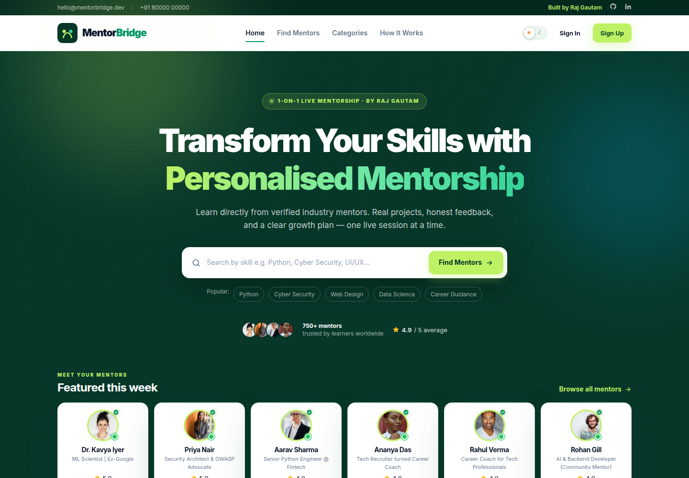
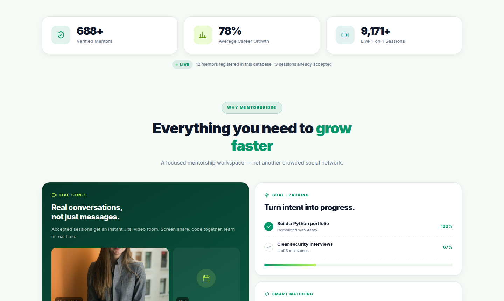
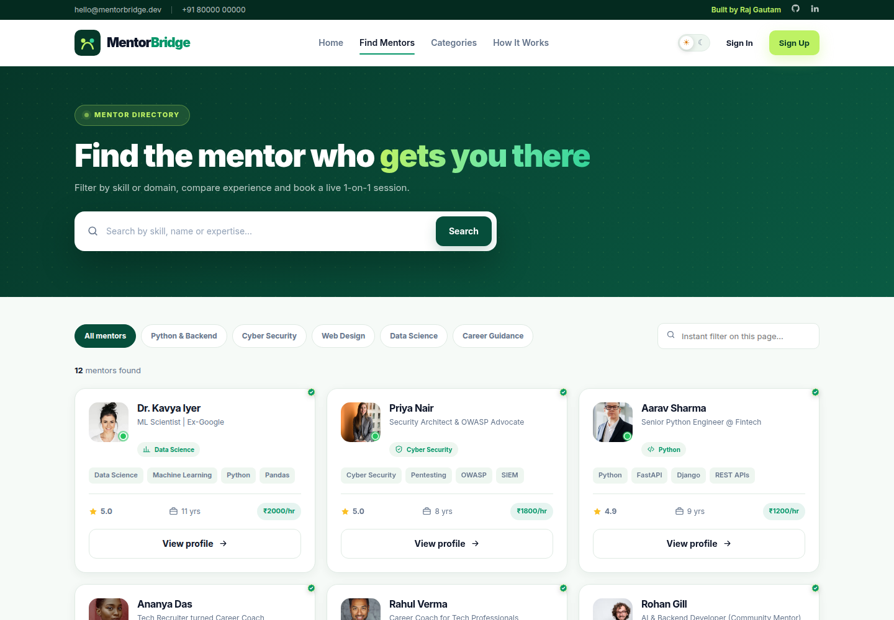
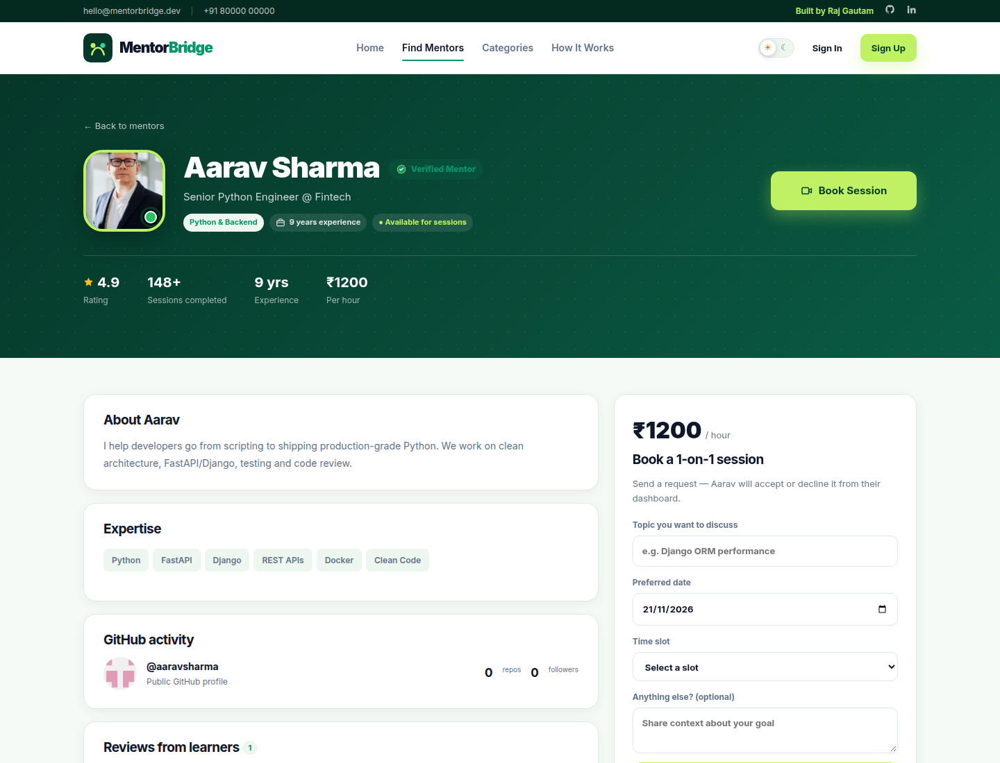
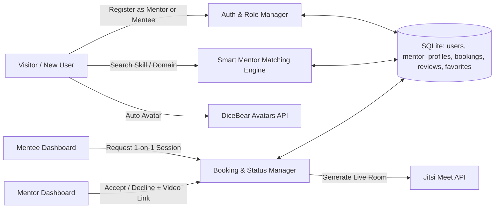

<div align="center">


# MentorBridge

**Peer-to-Peer & Expert Mentorship Network — built by [Raj Gautam](https://github.com/Rg100152)**

Real accounts, smart mentor discovery, 1-on-1 session booking and live video rooms — built with Flask, SQLite and zero-cost APIs.


</div>

---

## ✨ Features

- **Real authentication** — `/signup` and `/login` with PBKDF2 password hashing and Flask sessions.
- **Dual roles** — sign up as a **Mentee** (book sessions) or a **Mentor** (auto-listed in the public directory).
- **Smart matching** — search by skill, name or domain on the mentor directory, with instant client-side filtering.
- **Session lifecycle** — request → pending → accepted/declined → completed, with cancel and review actions.
- **Live video calls** — accepting a request generates a real, free `meet.jit.si` room link.
- **Auto avatars** — DiceBear avatars for new accounts; Unsplash portraits for seeded mentors (with automatic fallback).
- **GitHub verification** — live public repo/follower stats on mentor profiles via the GitHub REST API (no key).
- **Hybrid UI** — deep forest hero with an overlapping mentor strip + dark/light Bento grid.
- **60fps micro-animations** — staggered card reveals, pulse availability dots, magnetic spotlight hover and a success checkmark draw animation.
- **Responsive & accessible** — keyboard-friendly controls, reduced-motion support and mobile navigation.

## 📸 UI Showcase

| Forest-Emerald Hero & Overlapping Mentor Strip | Bento Analytics & Live Metrics |
| :---: | :---: |
|  |  |

| Searchable Mentor Directory | Mentor Profile & Booking Panel |
| :---: | :---: |
|  |  |

> [!TIP]
> **Reviewers:** sign up as a **Mentor** to list your skills automatically, or as a **Mentee** to request a live Jitsi video session. Use the demo logins below.

## 🧭 Data Flow Diagram



## 📁 Project structure

```text
mentorbridge-platform/
├── app.py                      # Flask app factory, DB init, context processor
├── seed_mentors.py             # 12 mentors + demo users, bookings and reviews
├── requirements.txt
├── README.md
├── .gitignore
├── database/
│   ├── schema.sql              # users, mentor_profiles, bookings, reviews, favorites
│   └── mentorbridge.db         # created automatically
├── routes/
│   ├── __init__.py             # DB helpers, login_required and role_required
│   ├── auth_routes.py          # /signup, /login, /logout
│   ├── main_routes.py          # /, /mentors, /mentor/<id>
│   └── dashboard_routes.py     # /dashboard, booking & profile actions
├── templates/
│   ├── base.html               # navbar, theme toggle, flash toasts, footer
│   ├── index.html              # forest hero + overlapping strip + bento grid
│   ├── mentors.html            # searchable/filterable directory
│   ├── mentor_profile.html     # bio, reviews, GitHub badge, booking modal
│   ├── auth.html               # split-screen signup/login
│   ├── dashboard.html          # dual role dashboard
│   ├── _icons.html             # reusable inline SVG icon macros
│   └── 404.html
└── static/
    ├── css/mentorbridge.css
    ├── js/themeAndFilter.js
    ├── js/bookingModal.js
    └── assets/
        ├── logo-mentorbridge.svg
        └── logo-mark.svg
```

## 🚀 Quick start

```bash
# 1. Virtual environment
python3 -m venv venv
source venv/bin/activate          # Windows: venv\Scripts\activate
pip install -r requirements.txt

# 2. Seed 12 mentors, 3 learners, bookings and reviews
python seed_mentors.py            # use --reset to reseed

# 3. Start the server
python app.py
# Open http://127.0.0.1:5000
```

### Demo logins (password: `demo1234`)

| Role | Email | What you can test |
| :--- | :--- | :--- |
| Mentor | `mentor@mentorbridge.dev` | Accept/decline requests, generate Jitsi link, edit profile |
| Mentee | `demo@mentorbridge.dev` | Book sessions, see statuses, save mentors, post reviews |

## 🔌 Zero-key external APIs

| API | Used for | Notes |
| :--- | :--- | :--- |
| [DiceBear Avatars](https://www.dicebear.com/) | Auto profile avatars | Deterministic SVG from the user's name |
| [Jitsi Meet](https://jitsi.org/) | Live 1-on-1 video rooms | `https://meet.jit.si/MentorBridge-<random>` generated on accept |
| [GitHub REST](https://docs.github.com/en/rest) | Mentor activity badge | Public profile data only; fails gracefully if unavailable |

## 🛡️ Notes

- Set `MENTORBRIDGE_SECRET` in your environment for a stable Flask secret key in production.
- The database file is ignored by Git — run `seed_mentors.py` on a fresh clone.
- No paid services, API keys or frontend build tools are required.

<div align="center">

**MentorBridge** · Made by [Raj Gautam](https://github.com/Rg100152) · Real bridges, real growth.

</div>
